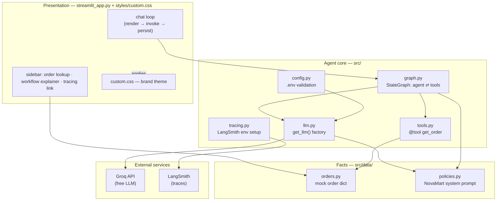
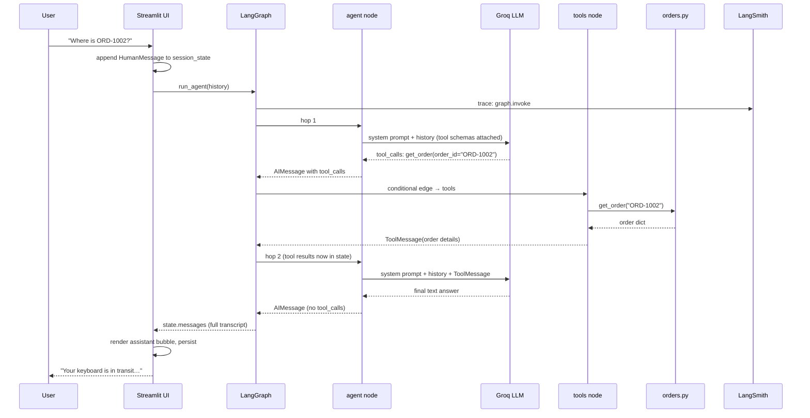
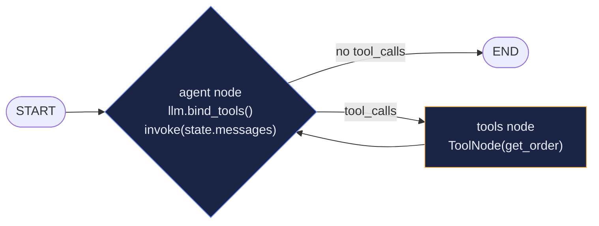
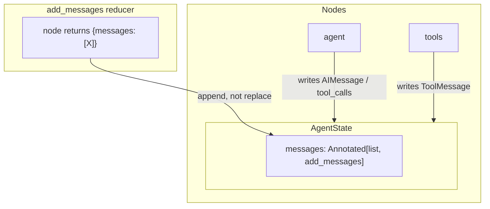
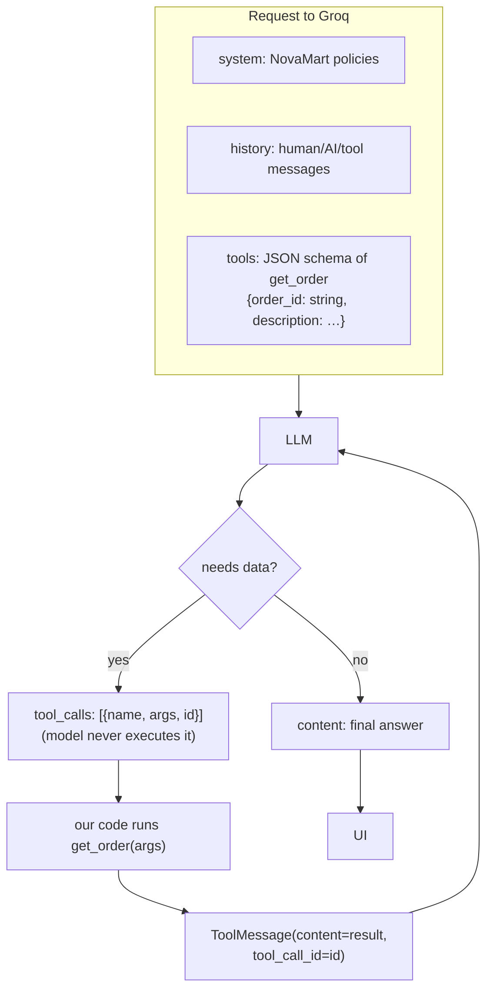
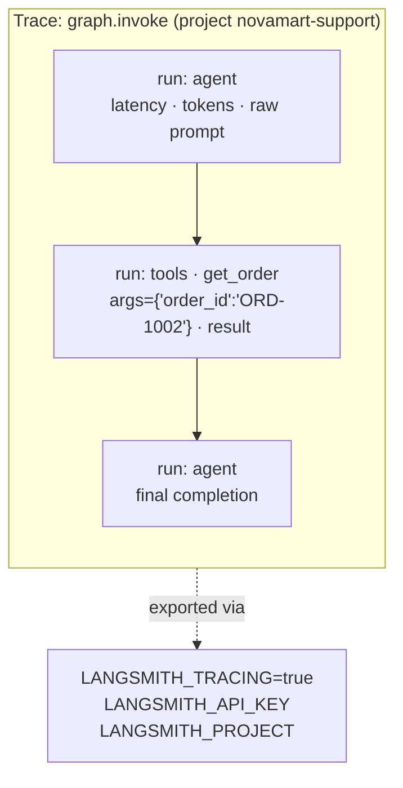
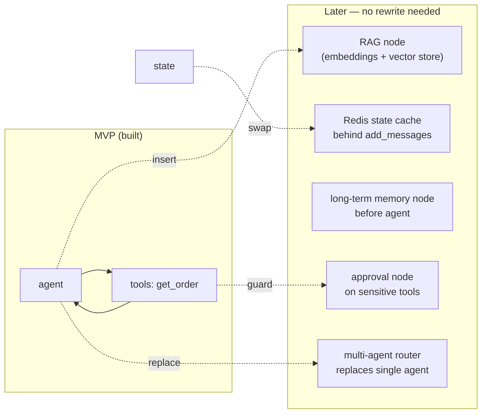

# Architecture — AI Customer Support Assistant

Visual guide to how a request moves through the system. Each diagram maps
1:1 to files in this repo — open them side by side while reading.

---

## 1. Module map — who owns what

**Rule of thumb:** `streamlit_app.py` never imports `ChatGroq` or knows tool
names; `graph.py` never renders anything. Swap UI or provider without
touching the other side.

---

## 2. Request flow — one user turn end-to-end

Notice: **the UI participates only at the start and end.** Everything
between is the graph — that's why the same graph can later serve an API,
Slack bot or CLI without rewriting agent logic.

---

## 3. LangGraph state graph

**State schema** (`src/graph.py`):

- **agent** — calls LLM; output is either final text or `tool_calls`.
- **tools** — prebuilt `ToolNode`; executes each requested tool by name.
- **conditional edge** — `_should_continue` inspects the last message:
  has `tool_calls`? → `tools`, else → `END`.
- **reducer** — `add_messages` appends; without it each hop would wipe history.

---

## 4. Tool-calling contract (what actually crosses the wire)

Key insight: the model only **requests** execution with JSON arguments;
Python runs the function and feeds the result back. Hallucination risk
drops because live data enters the conversation as a first-class message.

---

## 5. LangSmith trace anatomy

One user turn → one trace, nested runs:

- Span open/close comes from LangChain callbacks — **no tracing code in
  `graph.py`**; `tracing.py` only sets env vars at startup.
- Fail-open: missing key → spans simply never export; app behavior identical.
- Debug workflow: wrong answer → open trace → find first span whose
  input/output looks wrong (bad prompt? bad tool args? bad tool result?).

---

## 6. Where future features plug in

Each addition is `g.add_node(...)` + an edge — the reason Step 6 insisted
on an explicit graph instead of a loop in the UI.
