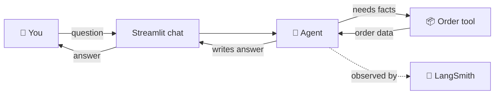
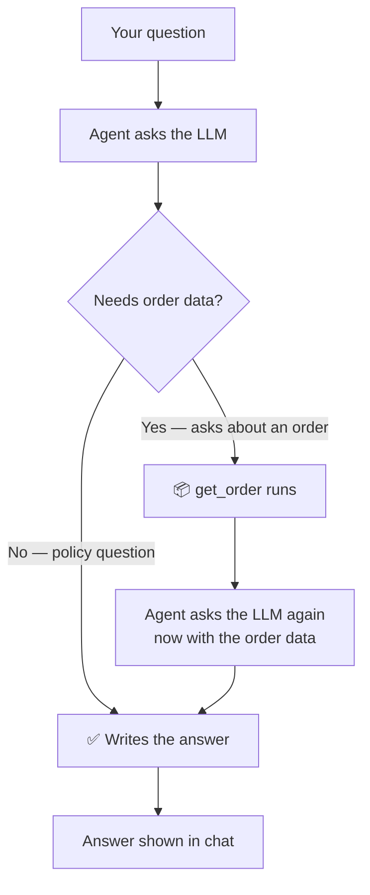
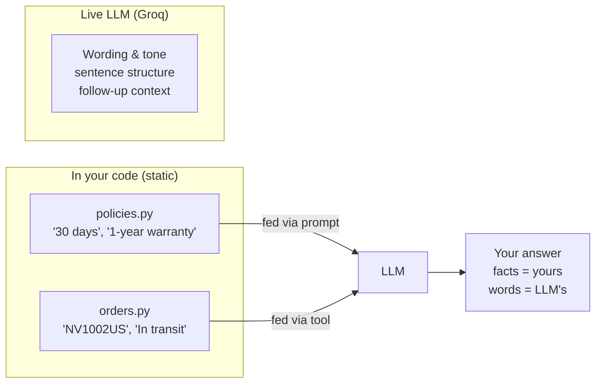
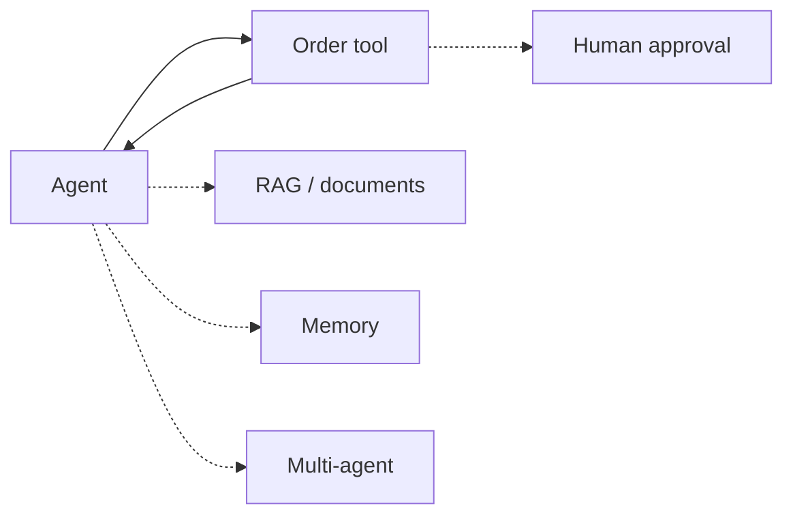

# Architecture — AI Customer Support Assistant

Three simple diagrams. No function-level detail — just the flow.

---

## 1. The big picture

**In words:** you type → chat app sends to agent → agent either knows the
answer (policies in its prompt) or fetches order data first → final answer
comes back to the chat. LangSmith watches everything.

---

## 2. Agent loop — how one reply is made

That's the whole agent: **ask → fetch if needed → ask again → answer.**

---

## 3. Where each answer comes from

- **Ask a policy question** → answer built from `policies.py`, phrased by the LLM
- **Ask about an order** → tool pulls from `orders.py`, LLM phrases it
- **Ask something off-script** → LLM either grounds in policies or
  escalates to a human agent (per instructions) — it never invents facts

---

## Where future features plug in

Each future feature is **one new box + one line** — the loop above never
gets rewritten. That's why the workflow lives in `src/graph.py` instead of
inside the UI.
