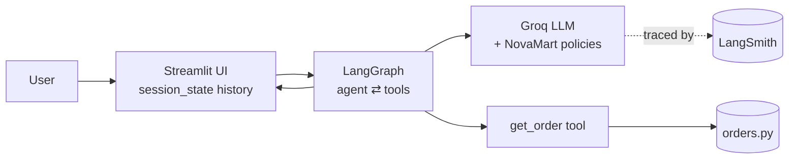

# AI Customer Support Assistant — NovaMart 🎧

A beginner-friendly customer support chatbot that demonstrates how **LLMs,
tool calling, workflows (LangGraph) and observability (LangSmith)** work
together — with a custom themed Streamlit UI.

NovaMart is a fictional electronics store. The assistant answers questions
about services, orders, delivery and refunds — grounding answers in company
policy text and retrieving live order data through a tool.

## Stack (and why each piece exists)

| Technology | Role |
|---|---|
| **Groq** (free tier) | Runs the LLM — fast, no credit card needed |
| **LangChain** | Provider-agnostic LLM interface + `@tool` definitions |
| **LangGraph** | Explicit workflow: `agent ⇄ tools` loop with typed state |
| **LangSmith** | Traces every hop so you can see what the agent did |
| **Streamlit** | Chat UI with custom NovaMart theme |

## Quickstart

```bash
# 1. Environment (Python 3.11+; use virtualenv if python3-venv is missing)
python3 -m virtualenv .venv && source .venv/bin/activate
pip install -r requirements.txt

# 2. Keys — both free, no credit card
cp .env.example .env
#    GROQ_API_KEY     ← https://console.groq.com/keys
#    LANGSMITH_API_KEY ← https://smith.langchain.com/settings (optional)

# 3. Run
streamlit run streamlit_app.py
```

Try: *"Where is ORD-1002?"* → watch the amber tool expander fire, then open
the trace link in the sidebar.

## Request flow



Deep dives (4 simple diagrams): **[ARCHITECTURE.md](ARCHITECTURE.md)** —
big picture, agent loop, where answers come from, future plug-in points.

### Viewing diagrams in VS Code

This workspace ships `.vscode/extensions.json` — VS Code will prompt to
install **Markdown Preview Mermaid Support** when you open the folder.

1. Open `ARCHITECTURE.md` or `README.md`
2. `Ctrl+Shift+V` (or click the preview icon, top-right)
3. Diagrams render inline; scroll — each section has one

If the prompt doesn't appear: `Ctrl+Shift+X` → search
`Markdown Preview Mermaid Support` → Install.

## Project layout

```
streamlit_app.py       # UI only: render → invoke graph → persist
styles/custom.css      # brand theme (tokens → chrome → bubbles)
src/
  config.py            # .env validation with human-readable errors
  llm.py               # get_llm() factory — the provider swap point
  tools.py             # @tool get_order (JSON schema auto-generated)
  graph.py             # StateGraph: agent ⇄ tools, typed state
  tracing.py           # LangSmith env setup (fail-open without key)
  data/orders.py       # mock order database
  data/policies.py     # NovaMart policies → system prompt (grounding)
demos/
  01_raw_llm.py        # baseline: raw API call, zero frameworks
  02_langsmith_trace.py# one turn + instructions to inspect the trace
ARCHITECTURE.md        # Mermaid diagrams (start here after LEARNING.md)
LEARNING.md            # step-by-step: what changed each commit & why
```

## Learning path

Work through [LEARNING.md](LEARNING.md) in order — each section maps to one
git commit:

1. Skeleton & mock data → 2. Raw LLM call → 3. Streamlit chat →
4. LangChain factory → 5. Tool calling → 6. LangGraph →
7. LangSmith → 8. Custom UI → 9. Docs

## Not in the MVP (on purpose)

RAG/embeddings, vector DBs, Redis, multi-agent, long-term memory,
human-in-the-loop, evals — `ARCHITECTURE.md` §6 shows where each plugs in
without rewrites.
