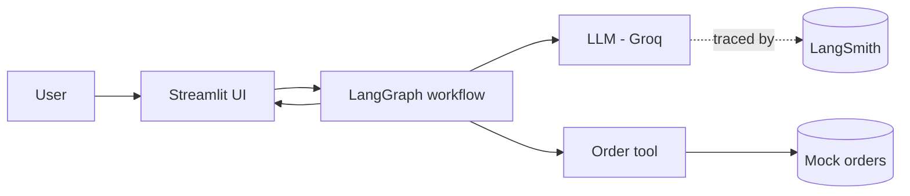

# AI Customer Support Assistant — NovaMart

A beginner-friendly customer support chatbot built to learn how **LLMs, tool
calling, workflows (LangGraph) and observability (LangSmith)** work together.

> Status: **Step 1 — project skeleton** (data + config files only, nothing runnable yet).

## What this project is

NovaMart is a fictional electronics store. The assistant answers questions
about services, orders, delivery and refunds — grounding answers in the
company policy text and retrieving live order data through a tool.

## Stack (and why each piece exists)

| Technology | Role |
|---|---|
| **Groq** (free tier) | Runs the LLM — fast, no credit card needed |
| **LangChain** | Standardized way to call the LLM + define tools |
| **LangGraph** | Explicit workflow: agent ⇄ tool loop with typed state |
| **LangSmith** | Traces every run so you can see what the agent did |
| **Streamlit** | Chat UI, custom NovaMart theme |

## Setup (finalized in later steps)

```bash
python3 -m venv .venv && source .venv/bin/activate
pip install -r requirements.txt
cp .env.example .env   # then paste your Groq key
```

## Request flow (Mermaid)

*(Diagrams are completed in Step 9 — this stub appears in Step 1 so the
structure is visible from the start.)*



## Project layout

```
streamlit_app.py      # UI entry point (added Step 3)
src/
  config.py           # env loading (added Step 2)
  llm.py              # LLM factory (added Step 4)
  tools.py            # order lookup tool (added Step 5)
  graph.py            # LangGraph workflow (added Step 6)
  data/orders.py      # mock order database
  data/policies.py    # NovaMart policies → system prompt
styles/custom.css     # custom theme (added Step 8)
demos/01_raw_llm.py   # raw API demo (added Step 2)
ARCHITECTURE.md       # deep-dive diagrams (Step 9)
LEARNING.md           # step-by-step notes (grows each step)
```

## Learning docs

- [LEARNING.md](LEARNING.md) — what changed in each step and why
- [ARCHITECTURE.md](ARCHITECTURE.md) — full diagrams (Step 9)
